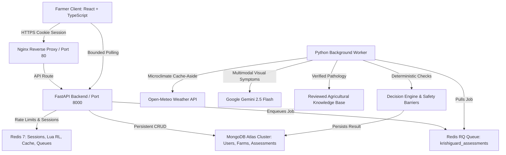

# KrishiGuard AI — System Architecture

## 1. System Overview
KrishiGuard AI is a full-stack, AI-powered agricultural decision-support platform designed to eliminate the fatal flaw of single-photo crop classifiers. It implements the **Farm Evidence Loop**, an integrated reasoning workflow that correlates visual evidence with local environmental microclimates, peer-reviewed plant pathology research, and deterministic safety rules.

---

## 2. Component Breakdown

### 2.1 Frontend (React 19, TypeScript, Vite, Tailwind CSS v4)
- **Role:** High-performance responsive, mobile-first interface for farmers.
- **Key Modules:**
  - `AuthContext`: Manages user credentials, automatic session hydration, and CSRF token propagation.
  - `DashboardPage`: Real-time weather monitoring and active diagnostic triage.
  - `NewAssessmentPage`: Multi-step wizard with client-side image validation and interactive synthetic test leaf generator.
  - `AssessmentDetailsPage`: Bounded polling (stops automatically on terminal state), step-by-step pipeline tracker, candidate rankings, and interactive follow-up clarification modal.
  - `FarmsPage`: GPS geolocation detection and farm boundaries management.

### 2.2 API Backend (FastAPI, Python 3.11+, Pydantic v2)
- **Role:** Request validation, authentication enforcement, authorization checks, and queue dispatch.
- **Key Subsystems:**
  - `Argon2id` Hasher: Memory-hard password hashing with parameters `m=65536, t=2, p=1`.
  - Redis Session Store: SHA-256 session key hashing (`kg:session:v1:{hash}`) with HttpOnly, SameSite cookies.
  - Atomic Sliding Window Rate Limiter: Redis Lua script preventing race conditions on login and assessment submissions.
  - Image Storage Service: Magic byte signature inspection (JPEG, PNG, WebP), PIL dimension bounds (50x50 to 4096x4096), and random UUID storage key generation.

### 2.3 The Farm Evidence Loop & Decision Engine
1. **Observe:** Farmer uploads crop photograph.
2. **Context:** Growth stage (seedling, vegetative, flowering, fruiting, harvest) and farmer-observed symptoms.
3. **Conditions:** Open-Meteo API retrieves local temperature, relative humidity, precipitation, and wind speed with Redis cache-aside (15 min TTL).
4. **Retrieve Evidence:** Reviewed agricultural sources from ICAR-IIHR, TNAU, PAU, and IARI.
5. **AI Reasoning:** Gemini 2.5 Flash extracts objective visual symptoms and identifies missing evidence without synthesizing speculative chemical advice.
6. **Evaluate:** Deterministic decision engine computes weighted match scores:
   - Visual Match: 40%
   - Farmer Symptoms: 30%
   - Weather Conduciveness: 20%
   - Growth Stage Plausibility: 10%
7. **Ask When Uncertain:** If top match score < 0.60 or image is degraded, switches status to `awaiting_farmer_input` and presents a targeted diagnostic follow-up question.
8. **Recommend Safely:** Filters recommendations through `SafetyChecker` to block dangerous chemical cocktails and unauthorized antibiotics (streptomycin).

### 2.4 Asynchronous Background Worker (RQ + Redis)
- Separate worker process handles heavy multimodal AI and external API calls.
- Bounded retries (3 attempts, interval `[5s, 15s, 30s]`), 180s job timeout, and terminal failure handling.
- Outbox pattern: Falls back gracefully if Redis queue is temporarily disconnected.
